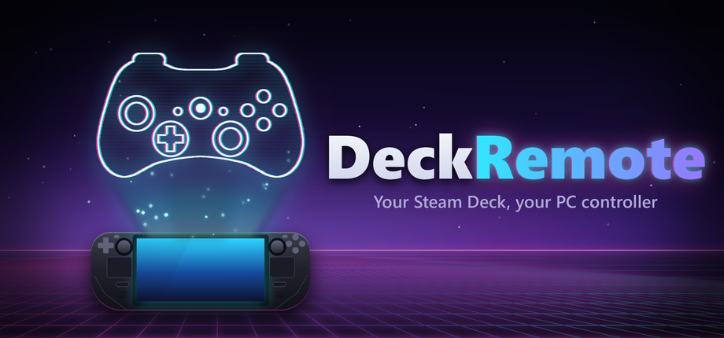
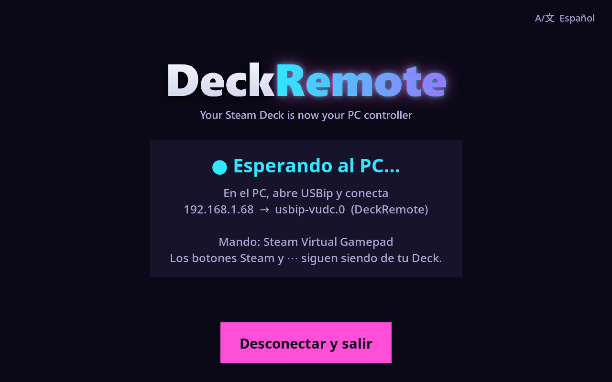
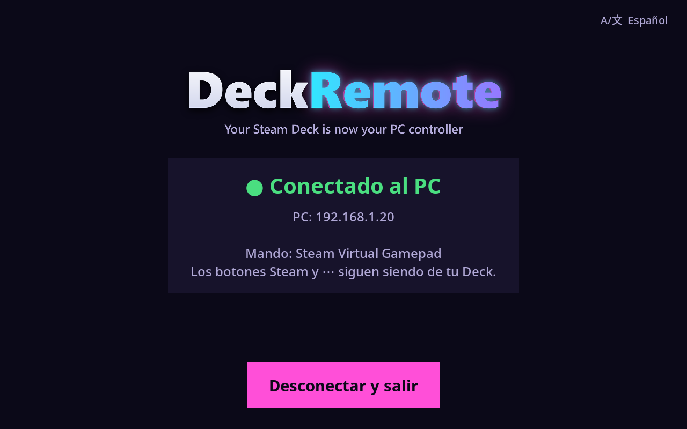
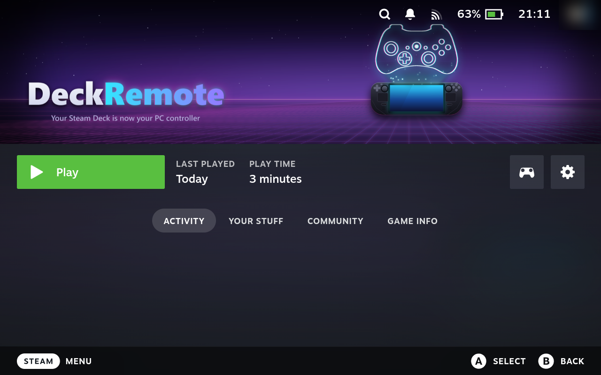
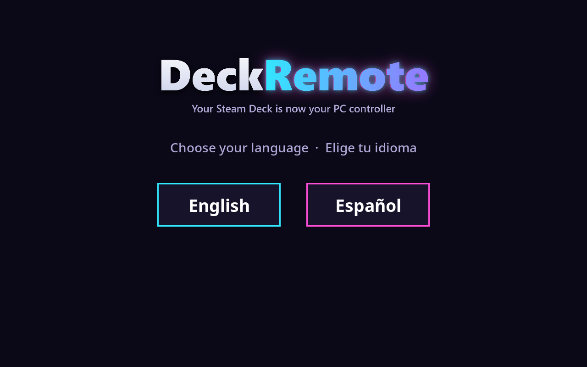

<p align="center"></p>

<p align="center"><b>Convierte tu Steam Deck en un mando inalámbrico para el PC, y ábrelo como cualquier juego de Steam.</b><br>
<a href="README.md">🇬🇧 Read in English</a></p>

---

Abres **DeckRemote** en la Steam Deck y tu PC con Windows detecta un **mando USB de toda la vida**. Funciona por la red de casa (Wi‑Fi o cable). No hacen falta cables entre los dos, ni cacharros extra, ni servicios en segundo plano.

- **Un mando de verdad en Windows.** Aparece como *HID-compliant game controller* en `joy.cpl`, en las webs de test de mandos y en los juegos que aceptan mandos genéricos (DirectInput / SDL).
- **La Deck sigue siendo tuya.** El botón Steam, el ⋯ y la pantalla táctil siguen funcionando en la Deck mientras juegas en el PC.
- **Usa tu configuración de Steam Input.** DeckRemote lee el mando que Steam da a los juegos, así que puedes asignar las palancas traseras, el giroscopio o los trackpads desde los ajustes del mando del acceso directo.
- **Nada funcionando de fondo.** No hay servicios al arrancar, y en el PC solo está el cliente USB/IP estándar. Todo se enciende al abrir la app y se apaga al cerrarla.

<p align="center">
  
  
</p>

> Probado con SteamOS 3.9 (kernel 7.2 "neptune") y Windows 11 con usbip-win2 0.9.8.1.

## Cómo funciona

```
 Steam Deck                                                   PC con Windows
 ┌────────────────────────────────────────────┐              ┌───────────────────────────┐
 │ Steam Input ─► "Steam Virtual Gamepad"     │              │                           │
 │                    │ SDL2                  │              │ usbip-win2 (cliente)      │
 │                    ▼                       │   USB/IP     │            │              │
 │ App DeckRemote ─► /dev/hidg0               │   TCP 3240   │            ▼              │
 │                    │                       │ ───────────► │ "HID-compliant game       │
 │ mando USB virtual (HID gadget en configfs) │              │  controller"              │
 │ en usbip-vudc, publicado con usbipd        │              │ (joy.cpl, juegos, webs)   │
 └────────────────────────────────────────────┘              └───────────────────────────┘
```

1. DeckRemote es un "juego" más de Steam, así que Steam le pasa un mando virtual con tu configuración de Steam Input.
2. La app crea en el kernel de la Deck un **dispositivo USB virtual**: un mando HID estándar.
3. **USB/IP**, que ya viene de serie en SteamOS, publica ese dispositivo por la red.
4. El PC lo conecta con el cliente gratuito **usbip-win2**, y Windows lo trata como si hubieras enchufado un mando por USB.

Todos los detalles en [docs/es/ARQUITECTURA.md](docs/es/ARQUITECTURA.md).

## Qué necesitas

| Equipo | Necesita |
|---|---|
| Steam Deck | SteamOS 3.x. Ya trae `usbipd`, `usbip-vudc`, `libcomposite`, `usb_f_hid`, y Python 3 con Tk y SDL2. También necesitas **contraseña de sudo** (si nunca pusiste una, ejecuta `passwd` en Konsole). |
| PC | Windows 10/11 x64 con [usbip-win2](https://github.com/vadimgrn/usbip-win2), un cliente USB/IP con driver firmado por Microsoft. |
| Red | Los dos equipos en la misma red local, y el PC tiene que llegar al puerto TCP **3240** de la Deck. |

## Instalación

### 1. Steam Deck (solo una vez)

1. Pasa a **Modo Escritorio** y abre **Konsole**.
2. Bájate este repositorio en la Deck (con `git clone` o descargando el ZIP) y ejecuta:

   ```bash
   bash deck/install.sh
   ```

   El instalador:
   - copia la app a `~/DeckRemote/`;
   - instala el ayudante `/etc/deckremote/gadget.sh` y una regla de sudo que permite **solo** `gadget.sh up|down|status` sin contraseña (te pide la contraseña de sudo una vez);
   - añade **DeckRemote** a tu biblioteca de Steam, con su arte (portada, banner, fondo y logo).
3. Vuelve al **Modo Juego**. DeckRemote estará en tu biblioteca, en *No de Steam*.

<p align="center"></p>

Si el instalador no pudo añadirlo a Steam, añádelo a mano. En Modo Escritorio abre Steam → *Juegos* → *Añadir un juego que no es de Steam* → *Examinar* → `~/DeckRemote/DeckRemote.desktop`. Después ejecuta `python3 ~/DeckRemote/set_artwork.py ~/DeckRemote/art` para poner el arte.

### 2. PC con Windows (solo una vez)

Abre PowerShell **como administrador** e instala el cliente USB/IP:

```powershell
winget install vadimgrn.usbip-win2
```

También puedes usar el instalador de [su página de releases](https://github.com/vadimgrn/usbip-win2/releases). Puede que Windows te pida reiniciar para cargar el driver.

## Cómo se usa

1. **Deck:** abre **DeckRemote**. La primera vez te pregunta el idioma (English / Español). Puedes cambiarlo cuando quieras con el botón de arriba a la derecha. La pantalla pone *Esperando al PC…* y muestra la IP de la Deck.

   <p align="center"></p>
2. **PC:** abre **USBip** desde el menú Inicio. Escribe la IP de la Deck en *Server* y pulsa *Add devices*. Elige **`usbip-vudc.0`** (*Linux Foundation : Multifunction Composite Gadget*) y pulsa *Attach*. Desde una terminal:

   ```powershell
   & "C:\Program Files\USBip\usbip.exe" attach -r <ip-de-la-deck> -b usbip-vudc.0
   ```

3. La Deck cambia a **● Conectado al PC** y muestra la IP de tu PC. ¡A jugar!
4. Para terminar, toca **Desconectar y salir** en la Deck, o sal del juego desde Steam (⋯ / botón Steam → *Salir del juego*). El mando virtual y USB/IP se apagan solos, y el PC ve el mando desconectado.

Para comprobarlo en Windows, pulsa `Win+R`, ejecuta `joy.cpl` y abre *Propiedades*, o usa cualquier web de test de mandos.

### Qué botón es cada uno

| Deck (plantilla de mando de Steam Input) | Mando virtual en Windows |
|---|---|
| A, B, X, Y | Botones 1, 2, 3, 4 |
| L1 / R1 | Botones 5 / 6 |
| Vista (⧉) / Menú (☰) | Botones 7 / 8 |
| L3 / R3 (pulsar los sticks) | Botones 9 / 10 |
| Cruceta | Hat (POV) |
| Stick izquierdo | Ejes X / Y |
| Stick derecho | Ejes Rx / Ry |
| L2 / R2 | Ejes Z / Rz (0–255) |
| Steam, ⋯ | **Se quedan en la Deck** (no se envían) |

## Desinstalar

En la **Deck**, ejecuta `bash deck/uninstall.sh` en Konsole. Después quita el acceso *DeckRemote* de la biblioteca (Steam → *Administrar* → *Eliminar juego que no es de Steam*).

En el **PC**, ve a *Configuración → Aplicaciones → USBip → Desinstalar*.

## Si algo falla

| Qué pasa | Por qué / cómo se arregla |
|---|---|
| **"Mando: no detectado"** | Abre DeckRemote **desde Steam**. El "Steam Virtual Gamepad" solo existe cuando es Steam quien abre la app. |
| **"Sin compartir"** | El ayudante no arrancó. En Konsole, ejecuta `sudo -n /etc/deckremote/gadget.sh up` y mira el error. Si te pide contraseña, la regla de sudo no se está aplicando: el archivo tiene que ser `/etc/sudoers.d/zz-deckremote`. |
| El PC no ve `usbip-vudc.0` | La app tiene que estar abierta en la Deck. Revisa la IP (la app la muestra) y el puerto: `Test-NetConnection <ip-de-la-deck> -Port 3240`. |
| USBip dice conectado pero `joy.cpl` no muestra nada | Cierra y vuelve a abrir la app en la Deck, y haz *Attach* otra vez. Cada vez que cierras la app hay que reconectar. |
| La Deck no responde a sus propios botones | Esta versión nunca toca el mando físico, así que no debería pasar. Si pasa, mantén pulsado el botón de encendido → *Reiniciar*. |
| Un juego no ve el mando | Ese juego solo acepta mandos **XInput** (de Xbox). Mira *Limitaciones*. |

## Seguridad

- **USB/IP no tiene contraseña ni cifrado.** Mientras la app está abierta, cualquier dispositivo de tu red local puede conectarse al mando virtual. Solo llega a ese mando, a nada más de la Deck. Úsalo en redes de confianza y ciérralo cuando acabes.
- La regla de sudo solo permite `/etc/deckremote/gadget.sh` con los argumentos fijos `up`, `down` y `status`. El script es de root y no acepta nada más.

## Limitaciones

- Aparece como **mando HID genérico**, no como mando de Xbox. Los juegos que solo aceptan XInput no lo ven. La emulación de mando de Xbox 360 está en la [hoja de ruta](docs/es/HOJA_DE_RUTA.md).
- Hay que hacer *Attach* en el PC cada vez que abres la app.
- El PC tiene que saber la IP de la Deck, así que mejor resérvala en el router.
- No hay vibración ni giroscopio nativo. El giroscopio sí se puede asignar a un stick desde Steam Input.

## Qué hay en el repositorio

```
deck/
  deckremote.py       la app (Python 3 + Tk + SDL2 vía ctypes), interfaz en inglés y español
  gadget.sh           ayudante root: crea y quita el mando USB virtual y usbipd
  make_descriptor.py  genera el descriptor HID
  set_artwork.py      pone el arte de la biblioteca de Steam en el acceso directo
  install.sh          instalador para la Steam Deck
  uninstall.sh        desinstalador
  art/                arte de la biblioteca (portada, banner, fondo, logo, icono)
tools/
  make_art.py         regenera deck/art (Pillow)
docs/
  ARCHITECTURE.md / ROADMAP.md   documentación en inglés
  es/                            documentación en español
  img/                           capturas
```

### Desarrollo

- Ver la interfaz sin Deck: `python deck/deckremote.py --demo --windowed`. Recorre los estados con datos de ejemplo y no toca USB ni mandos.
- En la Deck, sin interfaz y con el estado por terminal: `python3 ~/DeckRemote/deckremote.py --headless`.
- Regenerar el arte: `python tools/make_art.py` (necesita Pillow).
