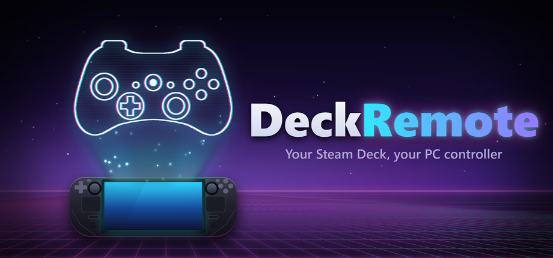
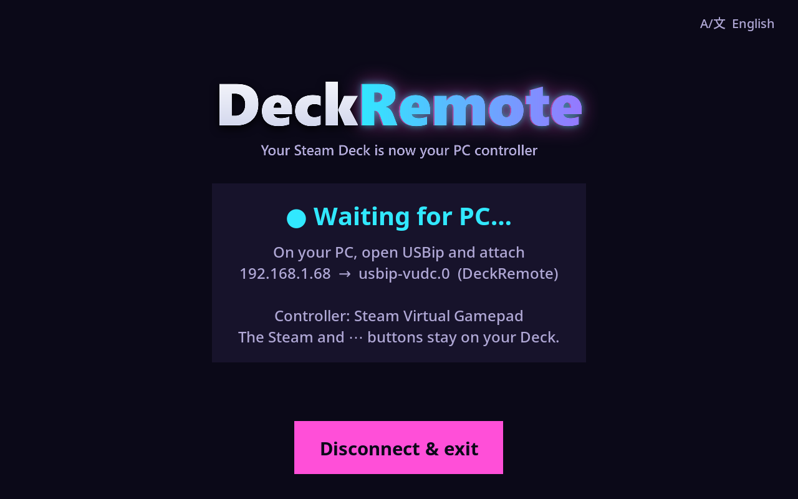
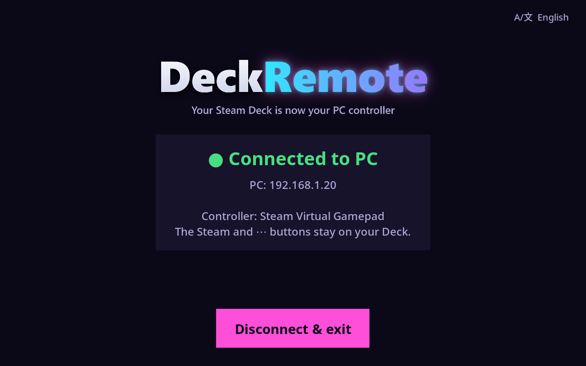
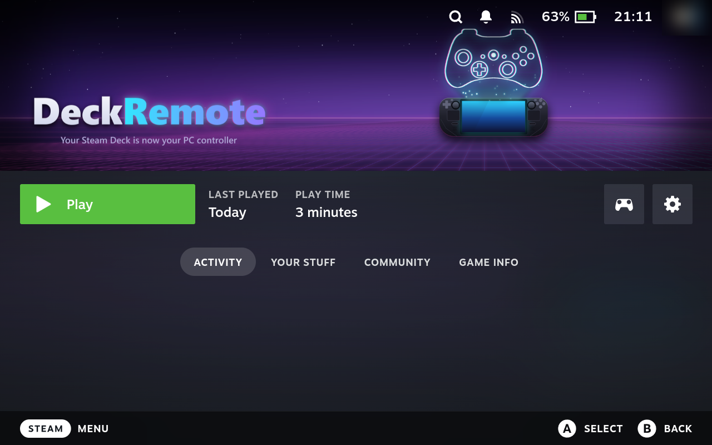
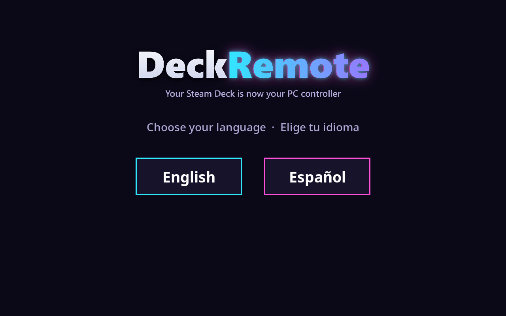

<p align="center"></p>

<p align="center"><b>Turn your Steam Deck into a wireless PC controller — launched like any Steam game.</b><br>
<a href="README.es.md">🇪🇸 Leer en español</a></p>

---

Open **DeckRemote** on your Steam Deck and your Windows PC sees a **standard USB gamepad**. It works over your home network (Wi‑Fi or cable). No cables between the two, no extra hardware and no background services.

- **A real gamepad on Windows.** It shows up as *HID-compliant game controller* in `joy.cpl`, in browser gamepad testers and in games that support generic controllers (DirectInput / SDL).
- **Your Deck stays yours.** The Steam button, the ⋯ button and the touchscreen keep working on the Deck while you play on the PC.
- **Uses your Steam Input layout.** DeckRemote reads the controller Steam gives to games, so back grips, gyro and trackpads can be mapped from the shortcut's controller settings.
- **Nothing runs in the background.** No services at boot, nothing on the PC but a standard USB/IP client. Everything starts when you open the app and stops when you close it.

<p align="center">
  
  
</p>

> Tested on SteamOS 3.9 (kernel 7.2 "neptune") and Windows 11 with usbip-win2 0.9.8.1.

## How it works

```
 Steam Deck                                                   Windows PC
 ┌────────────────────────────────────────────┐              ┌───────────────────────────┐
 │ Steam Input ─► "Steam Virtual Gamepad"     │              │                           │
 │                    │ SDL2                  │              │ usbip-win2 (USBip client) │
 │                    ▼                       │   USB/IP     │            │              │
 │ DeckRemote app ─► /dev/hidg0               │   TCP 3240   │            ▼              │
 │                    │                       │ ───────────► │ "HID-compliant game       │
 │ virtual USB gamepad (configfs HID gadget)  │              │  controller"              │
 │ on usbip-vudc, exported by usbipd --device │              │ (joy.cpl, games, web)     │
 └────────────────────────────────────────────┘              └───────────────────────────┘
```

1. DeckRemote is just another Steam "game", so Steam hands it a virtual controller with your Steam Input layout.
2. The app creates a **virtual USB device** in the Deck's kernel: a standard HID gamepad.
3. **USB/IP**, which ships with SteamOS, exports that device over the network.
4. Your PC attaches it with the free **usbip-win2** client, and Windows treats it like a gamepad plugged into a USB port.

Details: [docs/ARCHITECTURE.md](docs/ARCHITECTURE.md).

## Requirements

| Device | Needs |
|---|---|
| Steam Deck | SteamOS 3.x. It already ships `usbipd`, `usbip-vudc`, `libcomposite`, `usb_f_hid`, and Python 3 with Tk and SDL2. You also need a **sudo password** (run `passwd` in Konsole if you never set one). |
| PC | Windows 10/11 x64 with [usbip-win2](https://github.com/vadimgrn/usbip-win2), a USB/IP client with a Microsoft-signed driver. |
| Network | Both devices on the same local network, and the PC must reach TCP port **3240** on the Deck. |

## Install

### 1. Steam Deck (once)

1. Switch to **Desktop Mode** and open **Konsole**.
2. Get this repository onto the Deck (`git clone` or download the ZIP) and run:

   ```bash
   bash deck/install.sh
   ```

   The installer:
   - copies the app to `~/DeckRemote/`;
   - installs the helper `/etc/deckremote/gadget.sh` plus a sudo rule that allows **only** `gadget.sh up|down|status` without a password (it asks for your sudo password once);
   - adds **DeckRemote** to your Steam library and installs its library artwork.
3. Go back to **Game Mode**. DeckRemote is in your library under *Non-Steam*.

<p align="center"></p>

If the installer could not add the shortcut to Steam, add it by hand. In Desktop Mode open Steam → *Games* → *Add a Non-Steam Game* → *Browse* → `~/DeckRemote/DeckRemote.desktop`. Then run `python3 ~/DeckRemote/set_artwork.py ~/DeckRemote/art` to install the artwork.

### 2. Windows PC (once)

Open PowerShell **as administrator** and install the USB/IP client:

```powershell
winget install vadimgrn.usbip-win2
```

You can also use the installer from [its releases page](https://github.com/vadimgrn/usbip-win2/releases). Windows may ask you to reboot to load the driver.

## Use

1. **Deck:** open **DeckRemote**. On first launch, choose your language (English / Español). You can change it any time with the button at the top right. The screen shows *Waiting for PC…* and the Deck's IP address.

   <p align="center"></p>
2. **PC:** open **USBip** from the Start menu. Type the Deck's IP under *Server* and click *Add devices*. Select **`usbip-vudc.0`** (*Linux Foundation : Multifunction Composite Gadget*) and click *Attach*. From a terminal:

   ```powershell
   & "C:\Program Files\USBip\usbip.exe" attach -r <deck-ip> -b usbip-vudc.0
   ```

3. The Deck switches to **● Connected to PC** and shows your PC's IP. Play!
4. To stop, tap **Disconnect & exit** on the Deck, or quit the game from Steam (⋯ / Steam button → *Exit game*). The virtual gamepad and USB/IP shut down, and the PC sees the controller unplugged.

To check it on Windows, press `Win+R`, run `joy.cpl` and open *Properties*, or use any online gamepad tester.

### Button mapping

| Deck (Steam Input gamepad layout) | Virtual gamepad on Windows |
|---|---|
| A, B, X, Y | Buttons 1, 2, 3, 4 |
| L1 / R1 | Buttons 5 / 6 |
| View (⧉) / Menu (☰) | Buttons 7 / 8 |
| L3 / R3 (stick clicks) | Buttons 9 / 10 |
| D-pad | Hat switch (POV) |
| Left stick | X / Y axes |
| Right stick | Rx / Ry axes |
| L2 / R2 | Z / Rz axes (0–255) |
| Steam, ⋯ | **Stay on the Deck** (never sent) |

## Uninstall

On the **Deck**, run `bash deck/uninstall.sh` in Konsole. Then remove the *DeckRemote* shortcut from your library (Steam → *Manage* → *Remove non-Steam game*).

On the **PC**, go to *Settings → Apps → USBip → Uninstall*.

## Troubleshooting

| Symptom | Cause / fix |
|---|---|
| **"Controller: not detected"** | Launch DeckRemote **from Steam**. The "Steam Virtual Gamepad" only exists when Steam starts the app. |
| **"Not sharing"** | The helper didn't start. In Konsole, run `sudo -n /etc/deckremote/gadget.sh up` and read the error. If it asks for a password, the sudo rule isn't applied: the file must be `/etc/sudoers.d/zz-deckremote`. |
| The PC doesn't list `usbip-vudc.0` | The app must be open on the Deck. Check the IP (the app shows it) and the port: `Test-NetConnection <deck-ip> -Port 3240`. |
| USBip says attached but `joy.cpl` shows nothing | Close and reopen the app on the Deck, then *Attach* again. You need to re-attach every time the app is closed. |
| The Deck ignores its own controls | This version never touches the physical controller, so it shouldn't happen. If it does, hold the power button → *Restart*. |
| A game doesn't see the controller | That game only supports **XInput** (Xbox) controllers. See *Limitations*. |

## Security

- **USB/IP has no password and no encryption.** While the app is open, any device on your local network can attach the virtual gamepad. It can only reach that gamepad, nothing else on the Deck. Use DeckRemote on trusted networks and close it when you're done.
- The sudo rule only allows `/etc/deckremote/gadget.sh` with the fixed arguments `up`, `down` and `status`. The script is owned by root and accepts nothing else.

## Limitations

- It shows up as a **generic HID gamepad**, not an Xbox controller. Games that only support XInput won't see it. Xbox 360 emulation is on the [roadmap](docs/ROADMAP.md).
- You have to *Attach* on the PC each time you open the app.
- The PC needs to know the Deck's IP, so reserve it in your router.
- There's no rumble and no native gyro. The gyro can still be mapped to a stick in Steam Input.

## Repository layout

```
deck/
  deckremote.py       the app (Python 3 + Tk + SDL2 via ctypes), English/Spanish UI
  gadget.sh           root helper: creates/removes the virtual USB gamepad and usbipd
  make_descriptor.py  writes the HID report descriptor
  set_artwork.py      installs the Steam library artwork for the shortcut
  install.sh          Steam Deck installer
  uninstall.sh        Steam Deck uninstaller
  art/                Steam library artwork (capsule, header, hero, logo, icon)
tools/
  make_art.py         regenerates deck/art (Pillow)
docs/
  ARCHITECTURE.md     internals and design decisions
  ROADMAP.md          ideas to make DeckRemote a "4-click" install
  es/                 Spanish documentation
  img/                screenshots
```

### Development

- Preview the UI without a Deck: `python deck/deckremote.py --demo --windowed`. It cycles through the states with fake data and doesn't touch USB or controllers.
- Headless run on the Deck, with status printed to the terminal: `python3 ~/DeckRemote/deckremote.py --headless`.
- Regenerate the artwork: `python tools/make_art.py` (needs Pillow).
